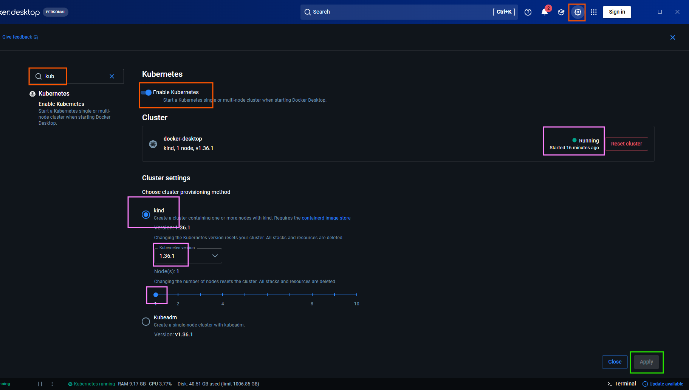

# Hướng dẫn cài đặt Spark trên Kubernetes

Tài liệu này chỉ triển khai riêng tầng Spark theo mô hình:

```text
Airflow hiện tại
    │ submit SparkApplication
    ▼
Kubernetes + Spark Operator
    ├── Spark Driver Pod
    └── Spark Executor Pods
            ├── MinIO hiện tại (Docker Compose)
            └── Nessie hiện tại (Docker Compose)
```

MinIO, Nessie, PostgreSQL, Trino và Airflow vẫn chạy bằng Docker Compose. Không cần cài Spark Standalone, Spark master/worker, Hadoop YARN hoặc HDFS.

## 1. Điều kiện ban đầu

- Docker Desktop đang chạy.
- Kubernetes đã được bật trong Docker Desktop.
- Máy có tối thiểu 4 CPU và 8 GB RAM dành cho Docker Desktop.
- PowerShell có thể gọi được `kubectl`.
- Repository nằm tại `C:\CODE\data-lakehouse`.

### 1.1 Cài `kubectl` nếu máy chưa có

Tải phiên bản `kubectl` tương thích với Kubernetes cluster. Ví dụ:

```powershell
curl.exe -LO "https://dl.k8s.io/release/v1.37.0/bin/windows/amd64/kubectl.exe"
```

Đặt `kubectl.exe` trong một thư mục cố định và thêm thư mục đó vào biến môi trường `PATH` của Windows. Sau đó mở lại PowerShell và kiểm tra:

```powershell
kubectl version --client
```

## 2. Bật Kubernetes trong Docker Desktop

Trong Docker Desktop:

1. Mở **Settings**.
2. Tìm **Kubernetes**.
3. Bật Kubernetes.
4. Chọn **Apply** và chờ cluster chuyển sang trạng thái running.



Kiểm tra context và cluster:

```powershell
kubectl config current-context
kubectl cluster-info
kubectl get nodes
kubectl get pods -A
```

Kết quả tối thiểu cần đạt:

```text
NAME                    STATUS   ROLES           VERSION
desktop-control-plane   Ready    control-plane   ...
```


## 3. Cài Helm

Helm là trình quản lý package cho Kubernetes, tương tự `pip` với Python hoặc `npm` với Node.js.

```powershell
winget install Helm.Helm
```

Sau khi cài xong, đóng terminal, mở lại và kiểm tra:

```powershell
helm version
```

## 4. Tạo namespace cho Spark

Namespace `spark-operator` chứa operator. Namespace `lakehouse-spark` chứa các Spark application, driver, executor, ServiceAccount và Secret của dự án.

```text
Kubernetes cluster
├── namespace: spark-operator
│   ├── Spark Operator Controller
│   └── Spark Operator Webhook
│
└── namespace: lakehouse-spark
    ├── SparkApplication
    ├── Spark Driver Pod
    ├── Spark Executor Pods
    ├── ServiceAccount
    └── Secret MinIO
```

Tạo namespace:

```powershell
kubectl create namespace lakehouse-spark
kubectl get namespace lakehouse-spark
```

Nếu namespace đã tồn tại, Kubernetes sẽ trả về lỗi `AlreadyExists`; có thể bỏ qua lỗi này.

## 5. Cài Spark Operator

Thêm Helm repository chính thức:

```powershell
helm repo add spark-operator https://kubeflow.github.io/spark-operator
helm repo update
```

Cài operator và cấu hình để theo dõi namespace `lakehouse-spark`:

```powershell
helm install spark-operator spark-operator/spark-operator `
  --namespace spark-operator `
  --create-namespace `
  --set "spark.jobNamespaces[0]=lakehouse-spark" `
  --wait
```

Lệnh có thể mất vài phút vì Kubernetes cần tải image. Không đóng terminal trong lúc Helm đang chờ.

### 5.1 Kiểm tra Spark Operator

```powershell
kubectl get pods -n spark-operator
```

Kết quả mong muốn:

```text
spark-operator-controller-...   1/1   Running
spark-operator-webhook-...      1/1   Running
```

Kiểm tra CRD:

```powershell
kubectl get crd | Select-String spark
```

Phải có tối thiểu:

```text
scheduledsparkapplications.sparkoperator.k8s.io
sparkapplications.sparkoperator.k8s.io
sparkconnects.sparkoperator.k8s.io
```

Kiểm tra ServiceAccount và Helm release:

```powershell
kubectl get serviceaccount -n lakehouse-spark
helm status spark-operator -n spark-operator
```

Namespace `lakehouse-spark` phải có ServiceAccount:

```text
spark-operator-spark
```

## 6. Chạy Spark Pi smoke test

Smoke test này xác nhận Spark Operator có thể tạo một driver pod và hai executor pods ở chế độ `cluster`. Nó chưa truy cập MinIO hoặc Nessie.

Chạy toàn bộ khối PowerShell sau:

```powershell
@'
apiVersion: sparkoperator.k8s.io/v1beta2
kind: SparkApplication
metadata:
  name: spark-pi
  namespace: lakehouse-spark
spec:
  type: Scala
  mode: cluster
  image: docker.io/apache/spark:3.5.0
  imagePullPolicy: IfNotPresent
  mainClass: org.apache.spark.examples.SparkPi
  mainApplicationFile: local:///opt/spark/examples/jars/spark-examples_2.12-3.5.0.jar
  arguments:
    - "1000"
  sparkVersion: "3.5.0"

  driver:
    cores: 1
    memory: 512m
    serviceAccount: spark-operator-spark

  executor:
    instances: 2
    cores: 1
    memory: 512m

  restartPolicy:
    type: Never
'@ | kubectl apply -f -
```

Kết quả tạo application:

```text
sparkapplication.sparkoperator.k8s.io/spark-pi created
```

Theo dõi trạng thái:

```powershell
kubectl get sparkapplication -n lakehouse-spark -w
```

Trạng thái dự kiến:

```text
SUBMITTED -> RUNNING -> SUCCEEDING -> COMPLETED
```

Nhấn `Ctrl+C` sau khi thấy `COMPLETED`. Trong lúc job chạy, có thể mở terminal khác để xem driver và executor:

```powershell
kubectl get pods -n lakehouse-spark -w
```

Kiểm tra kết quả Spark Pi:

```powershell
kubectl logs -n lakehouse-spark spark-pi-driver | Select-String "Pi is roughly"
```

Kết quả mong muốn:

```text
Pi is roughly 3.14...
```

Xóa application mẫu sau khi kiểm tra:

```powershell
kubectl delete sparkapplication spark-pi -n lakehouse-spark
```

## 7. Kiểm tra MinIO và Nessie hiện tại

MinIO và Nessie đang chạy trong Docker Compose và publish port ra Windows:

| Service | Docker Compose hostname | Port trên Windows |
|---|---:|---:|
| MinIO API | `minio:9000` | `9000` |
| MinIO Console | `minio:9001` | `9001` |
| Nessie | `nessie:19120` | `19120` |
| PostgreSQL | `postgres:5432` | `5433` |

Từ thư mục repository, kiểm tra container:

```powershell
cd C:\CODE\data-lakehouse
docker compose ps minio nessie postgres
```

Kiểm tra health endpoint từ Windows:

```powershell
Invoke-WebRequest -UseBasicParsing `
  -Uri "http://localhost:9000/minio/health/live"

Invoke-WebRequest -UseBasicParsing `
  -Uri "http://localhost:19120/api/v2/config"
```

Cả hai request phải trả về HTTP `200`.

## 8. Kiểm tra kết nối từ Kubernetes tới MinIO và Nessie

Docker Compose và Kubernetes sử dụng hai network khác nhau. Vì vậy Spark pod không dùng được DNS nội bộ Docker Compose như `minio` hoặc `nessie`, và cũng không nên hard-code IP container.

Trong môi trường Docker Desktop local, sử dụng:

```text
MinIO: http://host.docker.internal:9000
Nessie: http://host.docker.internal:19120/api/v2
```

Tạo pod kiểm tra mạng:

```powershell
kubectl delete pod lakehouse-network-test `
  -n lakehouse-spark `
  --ignore-not-found

kubectl run lakehouse-network-test `
  -n lakehouse-spark `
  --image=curlimages/curl:8.12.1 `
  --restart=Never `
  --command -- sh -c `
  "set -eu; curl -fsS http://host.docker.internal:9000/minio/health/live; echo MINIO_OK; curl -fsS http://host.docker.internal:19120/api/v2/config; echo; echo NESSIE_OK"
```

Pod có thể ở trạng thái `ContainerCreating` trong vài giây hoặc vài phút khi image được tải lần đầu. Kiểm tra trạng thái:

```powershell
kubectl get pod lakehouse-network-test -n lakehouse-spark -w
```

Sau khi pod chuyển sang `Completed`, xem log:

```powershell
kubectl logs -n lakehouse-spark lakehouse-network-test
```

Kết quả mong muốn:

```text
MINIO_OK
{
  "defaultBranch" : "main",
  "actualApiVersion" : 2,
  ...
}
NESSIE_OK
```

Xóa pod kiểm tra:

```powershell
kubectl delete pod lakehouse-network-test -n lakehouse-spark
```

## 9. Triển khai Spark runtime tích hợp Lakehouse

Sau khi Spark Pi và network test đều thành công, tiếp tục với image Spark tùy
biến và `SparkApplication` tích hợp Iceberg, Nessie, MinIO. Quy trình đầy đủ,
bao gồm build/push Docker Hub, tạo Secret và chạy smoke test, nằm tại:

[`k8s/spark/README.md`](../../k8s/spark/README.md)

Image hiện dùng:

```text
docker.io/tdang2202/cusc-datalakehouse:spark-3.5.0-v1
```

Manifest smoke test:

```powershell
kubectl apply -f k8s/spark/spark-iceberg-smoke-test.yaml
kubectl get sparkapplication spark-iceberg-smoke-test `
  -n lakehouse-spark -w
```

Khi trạng thái là `COMPLETED`, log driver phải có:

```text
LAKEHOUSE_SMOKE_TEST_OK
TABLE=lakehouse.spark_smoke.spark_k8s_smoke
ROW_COUNT=3
```

Kiểm tra cùng bảng qua Trino:

```powershell
docker compose exec trino trino `
  --execute 'SELECT * FROM lakehouse.spark_smoke.spark_k8s_smoke ORDER BY id'
```

Việc cả Spark và Trino đọc được cùng bảng xác nhận luồng tích hợp đang hoạt
động: Spark driver/executor trên Kubernetes, metadata Iceberg trong Nessie và
data file trong MinIO.

